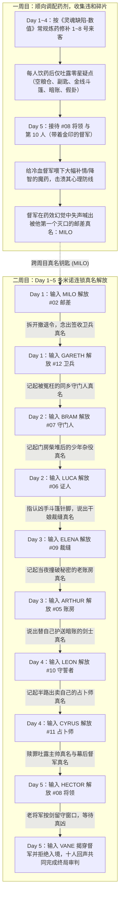

# 《埃吉斯孤城十人众》跨周目群像剧情大纲与人设

> 依据飞书知识库《灵魂缺陷-数值.md》中的首测灵魂编号、初始三维属性、缺陷定义与验证药方设计。
> 本案引用表中 9 位既有灵魂（含 **#06 不敢开口的证人**、**#08 执意守着空城的将领**、**#12 死守已经作废命令的卫兵**），并新建 1 位幕后真凶 NPC，构成横跨 Day 1 至 Day 5 的十人因果链。

---

## 一、 故事总纲：《孤城与作废的撤退令》

### 1. 表象与真相
- **表象（历史记载与一周目初印象）**：
  边境重镇「埃吉斯城」在围城战中陷落，全城军民覆没，化为一座死寂的空城。传闻是守门人通敌开城，主帅将领携全军死战殉国，唯有一名督军怀揣金印突围报信，最终却在渡海回京时触礁溺亡。
- **真相（二周目「真名解放」拼出的完整底牌）**：
  整场孤城惨案，是**督军（第 10 人）为了掩盖自己掏空军粮库的滔天贪腐，精心策划的「借刀杀人」**：
  1. 围城前，粮仓早已被督军倒卖一空。若大军奉命撤退、朝廷派员交接查账，督军必死无疑；唯有让整座城「全员战死」，才能死无对证。
  2. 王都其实早在城破前三天就派**邮差（#02）**送来了《全军撤退令》。督军在城外雪夜射杀邮差、截留公文，并向守卫内仓的**卫兵（#12）**谎称「撤退令已作废，誓死不准任何人打开粮仓门」。
  3. 城破当夜，督军逼迫北街**裁缝（#09）**连夜缝制了一件遮掩官服的平民斗篷，随后杀人灭口；又收买随军**占卜师（#11）**用「死守空城必有奇兵」的假卦稳住**将领（#08）**。
  4. 随后，督军披着斗篷用副匙亲手打开侧门放敌军入城，将打晕的**守门人（#07）**当场按上叛徒罪名吊死。
  5. 躲在门房柴堆后的少年**证人（#06）**目睹了一切，却在军法堂上遭督军灭门威胁而不敢开口；查出军粮亏空的**账房（#05）**被锁在屋内活活烧死；奉命护送暗账拓本的贴身护卫**守誓者（#10）**在占卜师的指认下遭伏击，被灌下失忆毒药并敲碎颅骨；而**将领（#08）**直到全城死绝，仍握着断剑守在空城帅帐中等待永远不会来的援军。

---

### 2. 跨周目运作机制：多米诺真名连锁

为了避免玩家因 10 位角色而重复刷 10 个周目，本剧情采用**「一周目终局拿起点钥匙 -> 二周目按日多米诺连锁解放」**的闭环设计，仅需**两个周目**即可走完十人全解放：

---

## 二、 十人排期、数值缺陷与真名总表

| 排期顺序 | 引用来源 | 未解放队列名 | 解放后真名 | 初始三维（智/情/意） | 灵魂缺陷定义 | 验证用药路线（以 7~9 为例） | 吐露的下一把真名钥匙 |
| --- | --- | --- | --- | --- | --- | --- | --- |
| **Day 1 - 1** | 缺陷表 `#02` | `对旧信无动于衷的邮差` | **米洛（`MILO`）** | `（8，5，8）` | 情感不足 | `冥河原液` -> `（8，7，8）` | `GARETH`（卫兵） |
| **Day 1 - 2** | 缺陷表 `#12` | `死守已经作废命令的卫兵` | **加雷斯（`GARETH`）** | `（8，8，10）` | 意志过高 | `回声原液` -> `（7，9，8）` | `BRAM`（守门人） |
| **Day 2 - 1** | 缺陷表 `#07` | `一想起冤情就慌了神的守门人` | **布拉姆（`BRAM`）** | `（6，10，5）` | 智慧、意志不足，情感过高 | `链颌原液` -> `（7，9，8）` | `LUCA`（证人） |
| **Day 2 - 2** | 缺陷表 `#06` | `不敢开口的证人` | **卢卡（`LUCA`）** | `（6，5，6）` | 三项不足 | `通情药` -> `（7，7，7）` | `ELENA`（裁缝） |
| **Day 3 - 1** | 缺陷表 `#09` | `只差一句安慰的裁缝` | **艾琳娜（`ELENA`）** | `（8，6，8）` | 情感不足 | `平情药（强化情+1）` 或 `冥河原液` -> `（8，8，8）` | `ARTHUR`（账房） |
| **Day 3 - 2** | 缺陷表 `#05` | `把每件旧事都反复推演的账房` | **亚瑟（`ARTHUR`）** | `（10，10，8）` | 智慧、情感过高 | `墨眼原液` -> `（9，9，8）` | `LEON`（守誓者） |
| **Day 4 - 1** | 缺陷表 `#10` | `忘了自己为何守誓的人` | **雷恩（`LEON`）** | `（0，5，10）` | 智慧归零、情感不足，意志过高 | `极识药` -> `（10，5，6）`，再 `渡魂原液` -> `（9，8，7）` | `CYRUS`（占卜师） |
| **Day 4 - 2** | 缺陷表 `#11` | `凡事都要算到尽头的占卜师` | **塞勒斯（`CYRUS`）** | `（10，8，8）` | 智慧过高 | `墨眼原液` -> `（9，7，8）` | `HECTOR`（将领）& `VANE`（督军） |
| **Day 5 - 1** | 缺陷表 `#08` | `执意守着空城的将领` | **赫克托（`HECTOR`）** | `（6，6，10）` | 智慧、情感不足，意志过高 | `负碑原液` -> `（9，7，9）` | 留守窗口配合审判 `VANE` |
| **Day 5 - 2** | **新建 NPC** | `怀揣金印的督军` | **维恩（`VANE`）** | `（9，3，8）` | 智慧过高，情感极度缺失 | `渡魂原液` -> `（8，6，9）`（或 `浓情药`） | **一周目饮药后漏出起点钥匙 `MILO`** |

---

## 三、 十人详细人设与跨周目表现

### Day 1：外围的信使与死命令

#### 1. `#02` 对旧信无动于衷的邮差 —— 米洛（`MILO`）
- **生前身份**：王都军邮驿使。
- **三维与缺陷成因 `（8，5，8）`**：
  常年奔波于前线送达阵亡通知书，为了不因信中成千上万条人命而崩溃，他强行麻痹了自己的同理心（`情感 5`）。城破前三天，他背着王都签发的《全军撤退令》抵达埃吉斯城外，却在雪夜里被城楼上射下的一支冷箭射穿咽喉。
- **立绘调查热点**：
  - `胸口染血的邮袋`（装着一封火漆完好、未被拆阅的军部急件）
  - `折断的羽箭尾羽`（制式并非敌军箭矢，而是埃吉斯城内部督军卫队的弩箭）
- **一周目表现（略见皮毛）**：
  眼神空洞，觉得送不送达都无所谓。饮下**冥河原液（情+2）**找回温度后，他捂着邮袋流下眼泪，惋惜这封救命的信终究没能送到城里那个「像木桩一样守着内门的傻卫兵」手上，但他记不起自己和那个卫兵的名字。
- **二周目「真名解放」（输入 `MILO`）**：
  真名唤醒了他驿使的职责与记忆。他当场拆开那封化为魂魄的《全军撤退令》，指着签收栏告诉你：这封信早在城破前三天就该由内门卫兵**加雷斯（`GARETH`）**转交全军，而射杀自己的人正是城楼上的督军！

#### 2. `#12` 死守已经作废命令的卫兵 —— 加雷斯（`GARETH`）
- **生前身份**：埃吉斯城军粮库正门卫兵，也是 `#09 裁缝` 的独生子。
- **三维与缺陷成因 `（8，8，10）`**：
  军令如山，他的执念已经化作顽石（`意志 10` 超出上限）。督军拿出一纸伪造的手令骗他说「王都撤退令已作废，任何人不得靠近或开启粮仓半步」，他便在烈火烧塌粮仓大门时依然保持持枪立正的姿势，至死未退半步。
- **立绘调查热点**：
  - `焦黑的长枪与门锁`（粮仓大门从外面被铁水焊死，根本不是为了防盗，而是为了不让人看里面）
  - `内衬缝着金线的旧护腕`（母亲裁缝艾琳娜为他缝制的平安物）
- **一周目表现（略见皮毛）**：
  站在接待窗口前仍像站岗一样吼着「命令未解除，不得通行」。饮下**回声原液（智-1/情+1/志-2）**卸下过载的死板意志后，他才茫然地放下枪：「奇怪……我守了粮仓整整十天，为什么身后的大仓里连一只老鼠啃麦子的动静都没有？还有，守外门的老大哥怎么可能通敌？」
- **二周目「真名解放」（输入 `GARETH`）**：
  得知米洛的撤退令从未作废后，加雷斯恍然大悟——自己死守的只是一座早被搬空的空仓！他向你敬礼致谢，并恳求你洗刷他同乡老大哥的冤屈，说出了外城门守门人的真名：**布拉姆（`BRAM`）**。

---

### Day 2：城破之夜的替罪羊与失声者

#### 3. `#07` 一想起冤情就慌了神的守门人 —— 布拉姆（`BRAM`）
- **生前身份**：埃吉斯城西侧门老守门人。
- **三维与缺陷成因 `（6，10，5）`**：
  城破当夜他被人从背后用闷棍打晕，醒来时敌军已从西侧门蜂拥而入，赶来的督军当场将他吊死在城门楼上定罪为「内奸」。巨大的冤屈与惊恐让他的情绪彻底失控（`情感 10` 爆表），一开口辩解就脑子发懵（`智慧 6`）、双腿发软（`意志 5`）。
- **立绘调查热点**：
  - `腰间完好无损的铜钥匙串`（他的正匙根本没有使用过的磨损痕迹）
  - `后脑勺的钝器伤与苦杏仁味`（打晕他的人身上涂着只有高官才用得起的苦杏仁香膏）
- **一周目表现（略见皮毛）**：
  在窗口涕泪横流、语无伦次地喊着「不是我开的门」。饮下**链颌原液（智+1/情-1/志+3）**镇定心神、补足理智与胆气后，他终于理清了头绪：「西侧门除了我的正匙，只有督军府有一把备用铜匙！那天夜里门房柴堆后面明明躲着那个送炭的小学徒，他一定看见是谁开的门了！」
- **二周目「真名解放」（输入 `BRAM`）**：
  真名让他彻底摆脱了屈辱的绞索。他清楚地记起被打晕前听见的脚步声，以及那个躲在柴堆后瑟瑟发抖的送炭少年学徒的真名——**卢卡（`LUCA`）**。

#### 4. `#06` 不敢开口的证人 —— 卢卡（`LUCA`）
- **生前身份**：城门房送炭的少年杂役，`#09 裁缝` 收养的干儿子。
- **三维与缺陷成因 `（6，5，6）`**：
  他在柴堆后亲眼看见一名披着灰斗篷的高官用副匙打开了城门。次日军法堂审讯守门人时，他被传唤作证，却对上了堂上督军那双阴鸷的眼睛与抹脖子的手势。极度的恐惧抽干了他的思考、情感与勇气（`6, 5, 6` 三项全低），他死死咬住嘴唇不敢吐露半个字，最终在城破时被乱兵踩死在街角。
- **立绘调查热点**：
  - `咬破出血的下唇`（因长期死咬牙关不敢发声而留下的伤口）
  - `死死攥在手心的一截金线线头`（开门真凶经过柴堆时，从斗篷下摆刮落的一截未剪净的金线）
- **一周目表现（略见皮毛）**：
  面对主角的询问只会拼命摇头、捂住嘴巴。饮下**通情药（智+1/情+2/志+1）**将三项全部补齐至及格线后，他才敢松开手，声音发颤地说：「那个人……身上的灰斗篷是连夜赶制的，内衬用的金线锁边针法，全城只有北街那位独眼裁缝会缝……」
- **二周目「真名解放」（输入 `LUCA`）**：
  少年恢复真名，愧疚与勇气一同涌上心头。他大声说出当夜真凶腰间挂着的正是督军金印，而那位被逼缝制潜逃斗篷后惨遭灭口的独眼女裁缝，正是他的干娘——**艾琳娜（`ELENA`）**。

---

### Day 3：城内的暗流——伪装与亏空

#### 5. `#09` 只差一句安慰的裁缝 —— 艾琳娜（`ELENA`）
- **生前身份**：北街独眼老裁缝，`#12 卫兵加雷斯` 的母亲、`#06 证人卢卡` 的干娘。
- **三维与缺陷成因 `（8，6，8）`**：
  城破前夜，她被秘密押进督军府，奉命在两个时辰内改制一件「表面像逃难平民、内里能藏住官印与金条」的灰斗篷。缝完最后一针后，她被当场刺死。她临死前看见窗外粮仓方向燃起大火，以为是自己贪生怕死缝制的这件斗篷害死了守粮仓的儿子，在自责与心死中封闭了情感（`情感 6`）。
- **立绘调查热点**：
  - `戴着铜顶针的右手`（指腹满是连夜赶工留下的深针眼）
  - `沾着陈年霉灰的剪刀`（她剪裁那位大人旧官袍时，发现袍角沾满了只有空粮仓底部才有的陈年谷糠霉灰）
- **一周目表现（略见皮毛）**：
  神情哀戚，低头反复摩挲着顶针。饮下**平情药（经浓缩强化情感+1）或冥河原液**后，她轻轻叹息：「要是有人能告诉我，我家那傻孩子不是因为我缝的这件衣裳才死在火里的，该多好……对了，那天我被押进督军府时，正撞见老账房抱着账本从里面冲出来，嘴里喊着什么『三年全空了』……」
- **二周目「真名解放」（输入 `ELENA`）**：
  当她通过真名共鸣得知儿子加雷斯与干儿子卢卡都已在冥河彼岸平安放下执念、且从未怪罪过她时，她终于得到了那句迟来的安慰。她擦干眼泪，告诉了你那位撞破粮仓亏空真相的老账房真名——**亚瑟（`ARTHUR`）**。

#### 6. `#05` 把每件旧事都反复推演的账房 —— 亚瑟（`ARTHUR`）
- **生前身份**：埃吉斯城军需处首席老账房。
- **三维与缺陷成因 `（10，10，8）`**：
  一辈子与数字打交道，头脑精密到了极点（`智慧 10` 过高），同时对全城三万军民怀有强烈的责任与负罪感（`情感 10` 过高）。他在围城第七天终于算穿了督军的假账：军粮早就被督军分十九批倒卖给了敌军！如果自己早半年看穿这本假账，三万人根本不用死。他被督军锁在账房里放火烧死，死后魂魄仍在用烧焦的算盘疯狂验算每一笔账目。
- **立绘调查热点**：
  - `烧焦的紫檀算盘`（算珠停在「零」的位置——代表存粮早就是零）
  - `少了一半的血书封皮`（他死前将真正的暗账拓本撕下，塞进了一名忠心护卫的胸甲夹层）
- **一周目表现（略见皮毛）**：
  语速极快地背诵着枯燥的粮草出入数字，完全听不进外界的声音。饮下**墨眼原液（智-1/情-1）**平息了过载的算计与悲愤后，他才停下手指：「账目没有算错，是我低估了那头蛀虫的狠毒。只要城破人亡，就没人查得清这三年的空账了……也不知道那个替我送暗账去帅帐的年轻剑士，有没有活着走过占卜师的巷子。」
- **二周目「真名解放」（输入 `ARTHUR`）**：
  亚瑟恢复真名，不再困于无意义的自我折磨。他将整条贪腐铁证整理成册交给你，并郑重托付你唤醒那位替他护送暗账而惨遭毒手的年轻护卫——**雷恩（`LEON`）**。

---

### Day 4：被抹去的血誓与算尽的棋局

#### 7. `#10` 忘了自己为何守誓的人 —— 雷恩（`LEON`）
- **生前身份**：主帅将领麾下的贴身暗卫剑士。
- **三维与缺陷成因 `（0，5，10）`**：
  《灵魂缺陷-数值》中最极端的一组数据（`智慧 0，情感 5，意志 10`）。他立下血誓要把亚瑟的暗账送到将领手中，却在途经随军占卜师帐篷时被出卖行踪，遭督军亲信围攻。敌人灌下了能烧毁记忆的「忘川散」并用重锤击碎了他的颅骨。他彻底丧失了记忆与神智（`智慧 0`），甚至忘了自己是谁、要送什么（`情感 5`），却只凭肌肉本能死死按住胸口直到流尽最后一滴血（`意志 10`）。
- **立绘调查热点**：
  - `凹陷的头盔与空洞的双眼`（重度颅脑创伤与毒药导致他连完整的句子都说不出）
  - `被血焊死在胸甲内侧的左手`（即使成了亡灵，谁去掰他的手指都会遭到本能的反击）
- **一周目表现（略见皮毛）**：
  开场只有破碎的单字：「守……誓……送……」。玩家必须动用深水巨刺灰鳞鱼炼制的**极识药（智+10/志-4）**补回他归零的智慧，再喂下一份**渡魂原液（智-1/情+3/志+1）**使三维回到 `（9，8，7）`。药效生效的瞬间，他眼神恢复清明，看着自己空空如也的胸甲喃喃道：「我是去给将军送东西的……半路上下着大雪，那个摇铜钱的占卜师把我骗进了死胡同……」
- **二周目「真名解放」（输入 `LEON`）**：
  在真名的呼唤下，雷恩终于松开了死死按住胸甲的左手，从魂魄夹层中取出那份染血的《军粮暗账拓本》！他指向身后，冷冷报出了那个为求活命而出卖他的随军占卜师真名——**塞勒斯（`CYRUS`）**。

#### 8. `#11` 凡事都要算到尽头的占卜师 —— 塞勒斯（`CYRUS`）
- **生前身份**：埃吉斯城随军占卜师。
- **三维与缺陷成因 `（10，8，8）`**：
  自诩能算尽天下人心与吉凶（`智慧 10` 过高）。他在围城之初就算出粮仓已空、孤城必破；为了换取督军手里的唯一一条出城密道钥匙，他选择与虎谋皮——一方面向将领献上「紧闭城门、死守待援」的假大吉卦象，另一方面帮督军算出了护卫雷恩的路线。结果当他钻进密道时，督军从外面推倒巨石将密道彻底封死。他死在黑暗中，魂魄仍在疯狂推演自己究竟算漏了哪一步。
- **立绘调查热点**：
  - `裂成两半的龟甲与六枚铜钱`（卦象原本是「大凶·速退」，却被他用朱砂硬改成了「大吉·死守」）
  - `指甲缝里抠出的密道石灰`（被封死在密道里绝望刨墙留下的痕迹）
- **一周目表现（略见皮毛）**：
  在窗口神经质地抛着铜钱，嘴里念叨着「不应该啊，每一步最优解我都算过了」。饮下**墨眼原液（智-1/情-1）**削去过度算计的魔障后，他惨然自嘲：「原来从一开始，那位大人就没打算让任何知情人活着走出埃吉斯城……可怜那位老将军，到现在还把我的假卦供在帅案上当救命稻草呢。」
- **二周目「真名解放」（输入 `CYRUS`）**：
  被叫破真名的塞勒斯面如死灰。面对雷恩留下的血书，他明白自己聪明一世却成了屠城帮凶。为了在投胎前赎回一点罪孽，他向你吐露了整座孤城最后两个核心名字——仍在空城死守的主帅**赫克托（`HECTOR`）**，以及马上就要拿着抚恤金来冥河报到的幕后真凶督军**维恩（`VANE`）**！

---

### Day 5：孤城的盲将与微笑的蛀虫

#### 9. `#08` 执意守着空城的将领 —— 赫克托（`HECTOR`）
- **生前身份**：埃吉斯城守城主帅。
- **三维与缺陷成因 `（6，6，10）`**：
  他并非无能之辈，却被「军人以服从和死守为天职」的教条捆死了手脚（`意志 10` 过高）。为了不让军心涣散，他强行压抑对麾下士卒伤亡的悲恸（`情感 6` 不足），又被督军的假账与占卜师的假卦蒙蔽了双眼（`智慧 6` 不足）。直到全城只剩他一人，他依然拄着重剑坐在空无一人的帅帐里，等待根本不存在的援军，最终力竭而亡。
- **立绘调查热点**：
  - `卷刃的守城重剑`（剑身上刻着「人与城存亡」，却唯独没有敌将的血，因为城是从内部溃烂的）
  - `帅印旁那道早已被偷换的假军令`（督军塞给他的死守令）
- **一周目表现（略见皮毛）**：
  即使到了冥河窗口，他也拒绝跨过冥府之门，执拗地认为「我若退了，身后的三万弟兄怎么办」。饮下**负碑原液（智+3/情+1/志-1）**补全理智与悲悯、卸下盲目的死志后，老将军浑身剧震，终于想通了前因后果，老泪纵横：「原来没有援军……原来粮仓早就空了！是我这个瞎了眼的主帅，把三万弟兄带进了绝路啊！」
- **二周目「真名解放」（输入 `HECTOR`）**：
  真名让老将军化作威严的英灵本相。当你将前八人留下的《撤退令》《门房证词》《军粮暗账》一一呈现在他面前时，赫克托握紧重剑，向你郑重抱拳——他请求暂缓跨过转生之门，而是按剑立在你的窗口一侧：「引渡者，那头害死我全城军民的蛀虫就在后面。请让我亲眼看着他受审！」

#### 10. 【新建 NPC】怀揣金印的督军 —— 维恩（`VANE`）
- **生前身份**：埃吉斯城监军督军兼军需总监，孤城惨案的幕后真凶。
- **三维与缺陷成因 `（9，3，8）`**：
  极度精明阴险（`智慧 9` 偏高），对三万军民的死活毫无愧疚（`情感 3` 极度缺失），且有着强烈的求生与敛财欲望（`意志 8`）。他用一件金线灰斗篷混出自己亲手打开的城门，带着督军金印和搜刮来的黄金登上回京的快船，准备去领「孤城唯一幸存忠烈」的封赏，却在半途遭遇风暴沉船溺毙。
- **立绘调查热点**：
  - `怀里死死护住的督军金印与抚恤金箱`（沉船时正是因为舍不得撒手这箱金子才被拖入海底）
  - `领口露出的灰斗篷金线锁边与苦杏仁香膏瓶`（与 `#07 守门人`、`#06 证人`、`#09 裁缝` 的证词完全吻合的铁证）
- **一周目表现（全链条的起点钥匙产出点！）**：
  - 初到窗口时满脸矜持的微笑，自称「突围求援不幸遇难的忠臣」，还想拿金子贿赂主角快点放行。
  - 玩家为了满足 Day 5 的属性区间（需降低其过高的智慧、大幅提升其缺失的情感），给他喂下**渡魂原液（智-1/情+3/志+1）或浓情药（智-2/情+6/志+2）**。
  - **关键剧情触发**：药效入喉的瞬间，从未有过良知波动的督军突然冷汗直流、神智恍惚。他在药力催动的情感反噬下看见了漫天风雪，惊恐地挥手大喊：
    > 「别看我！谁让你在大雪天非要把《撤退令》送到城下来的！要怪就怪你自己多事，邮差**米洛（`MILO`）**！我射死你也是迫不得已！」
  - 喊完之后他才猛然惊醒，慌忙捂住嘴，催促主角赶紧放他过门投胎——**玩家由此在一周目结尾拿到了开启二周目十人连锁的第一把真名钥匙：`MILO`！**
- **二周目「真名解放」（输入 `VANE` · 终局审判）**：
  - 玩家在窗口直接输入 **`VANE`** 叫破其真名，右下角按钮切换为**「拒绝入境」**。
  - 维恩惊骇地发现，不仅眼前的骷髅守卫知道他的真名，连窗口阴影里都站着按剑怒目的赫克托将军，以及邮差、卫兵、守门人、证人、裁缝、账房、守誓者、占卜师的九道幽魂回声。
  - 玩家点击「拒绝入境」后，维恩连同他怀里的金印一起被冥河深处的灰手拖入塔尔塔罗斯深渊；而赫克托将军与埃吉斯城的九位亡灵向你的窗口齐齐行礼，安然踏入转生之门。

---

## 四、 与 Day 5 阿努比斯终局听证的联动

当玩家在二周目完成「埃吉斯孤城十人众」的全员真名解放并审判督军维恩后，在 Day 5 最后一位来客**阿努比斯**的称心听证环节，可触发一段专属的隐藏评语：

> **阿努比斯**：「还有那座名叫埃吉斯的孤城……一共十个支离破碎的亡灵。按冥界的规矩，你本只需给他们灌下魔药、把他们糊里糊涂地送进转生门了事；可你却用真名把一桩死无对证的屠城冤案，在阿刻戎河边一环一环地拼了回来。小骷髅，连奥西里斯的审判庭，也未必有你这扇小窗口看得明白。」
